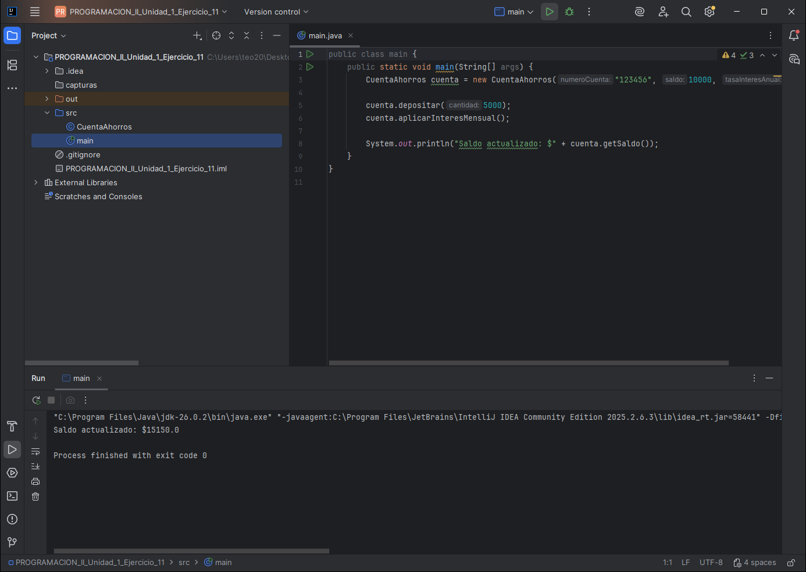

# PROGRAMACIÓN II — Unidad 1, Ejercicio 11: Gestión de Cuenta de Ahorros con Interés

Trabajo práctico de Programación II. Este repositorio contiene la resolución en Java del ejercicio 11 de la Unidad 1.

## Consigna

#### Contexto

Las entidades bancarias manejan cuentas de ahorros que acumulan un rendimiento financiero mensual en función de una tasa de interés fija aplicada sobre el saldo actual.

#### Consigna

Diseñar un programa en Java que modele una cuenta de ahorros capaz de calcular y aplicar intereses periódicos sobre el capital depositado.

#### Desarrollo requerido

- Definir la clase CuentaAhorros con los atributos privados numeroCuenta (String), saldo (double) y tasaInteresAnual (double).
- Incorporar un constructor que reciba e inicialice estos atributos, validando que el saldo y la tasa no sean negativos.
- Implementar un método aplicarInteresMensual() que incremente el saldo calculando la proporción mensual correspondiente ($saldo \times (tasaInteresAnual / 12) / 100$), además de métodos para depositar y retirar fondos.
- En el método main, instanciar una cuenta de ahorros, simular un depósito, aplicar el interés mensual y mostrar el saldo actualizado por consola.

## Estructura del repositorio

```
PROGRAMACION_II_Unidad_1_Ejercicio_11/
├── README.md
├── capturas/
│   └── consola.png
└── src/
    ├── CuentaAhorros.java
    └── main.java   # clase con el método main
```

## Funcionamiento y lógica

### `CuentaAhorros`

Representa una caja de ahorro con los atributos privados `numeroCuenta`, `saldo` y `tasaInteresAnual`.

- **Constructor:** no acepta saldo ni tasa negativos; si llegan valores negativos, los deja en 0 y lo informa.
- **`depositar(double)`:** suma el monto al saldo solo si es mayor a cero.
- **`retirar(double)`:** resta el monto solo si es positivo y no supera el saldo disponible.
- **`aplicarInteresMensual()`:** calcula el interés de un mes dividiendo la tasa anual por 12 (`saldo * (tasa / 12) / 100`) y lo suma al saldo.
- **`getSaldo()`:** devuelve el saldo actual.

### `main`

Crea la cuenta `123456` con $10000 y una tasa anual del 12 %. Deposita $5000 (saldo de $15000) y aplica el interés mensual del 1 %, que suma $150. El saldo final es **$15150.0**.

## Ejecución

Captura de la consola de IntelliJ IDEA ejecutando el programa:



Salida obtenida:

```
Saldo actualizado: $15150.0
```
